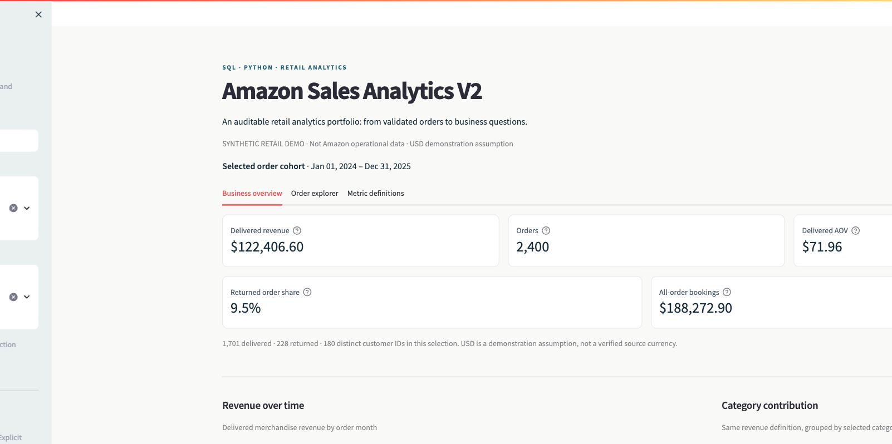
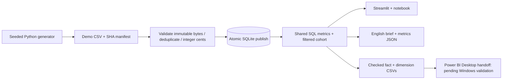
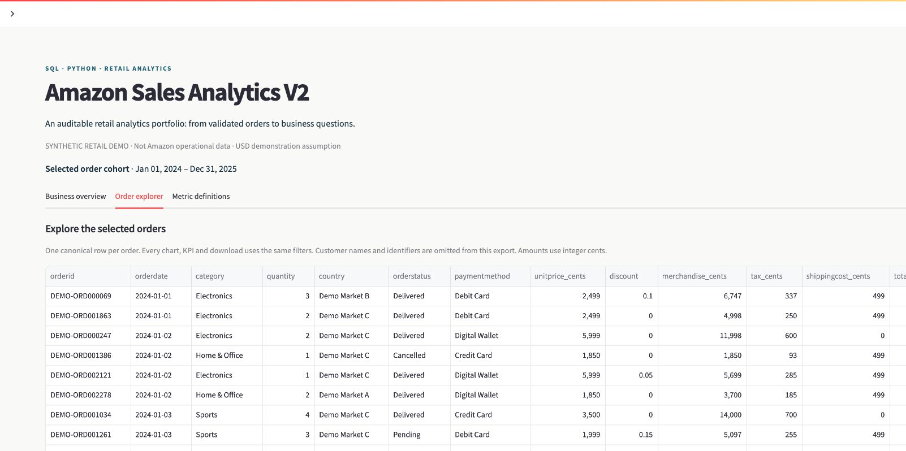

# Amazon Sales Analytics V2

**An auditable SQL + Python retail analytics portfolio:** validated order data, explicit revenue definitions, a shared SQLite metric layer, an interactive Streamlit dashboard, and checked CSV tables for a future Power BI report.

> **Synthetic demonstration, not Amazon operational data.** The default dataset is independently generated from retained Python source: 2,400 invented orders, 2024–2025, with USD as an explicit assumption. The inherited 100K-row `Amazon.csv` has unverified provenance/license and inconsistent dimensions; it is preserved for audit and excluded from the V2 demo.



## Start here

Verified locally on macOS with Python 3.11; GitHub CI uses Ubuntu/Python 3.11.

```bash
git clone --branch portfolio-v2 https://github.com/HY-D1/amazon-sales-analytics.git
cd amazon-sales-analytics
./start.sh setup
./start.sh build
./start.sh test
./start.sh check
./start.sh dashboard
```

Open `http://127.0.0.1:8501`. Setup installs pinned dependencies into `.venv`; build generates the independent fixture, validates and publishes SQLite, then exports the analytical brief and BI tables. Nothing requires Docker, paid services or an external dataset download.

On Windows, equivalent modes are available through `start.bat`; that launcher remains **unverified on Windows**. Power BI Desktop import/DAX execution also remains pending on supported Windows. The Python/SQL/Streamlit and BI-export work described here is executable and tested; no PBIX is claimed.

For an exact copy of the verified package environment, create a Python 3.11 virtual environment and install `requirements-lock.txt`. `requirements.txt`/`requirements-dev.txt` retain direct dependency choices. `pyarrow==17.0.0` prevents the observed incompatibility between newer PyArrow and the project's NumPy 1.x pin.

## Review how every number was made

**[Processing trace](docs/PROCESSING_TRACE.md)** maps each retained `.py` and `.sql` file to its inputs, outputs, transformations, command and checks. This is the entry point for reviewing the work.

| Read / run | What it demonstrates |
|---|---|
| [Data audit](docs/DATA_AUDIT.md) | Evidence-led rejection of inconsistent/unverifiable source assumptions; includes a read-only reproduction block |
| [Demo generator](scripts/generate_demo_data.py) | Seeded data construction, stable dimensions, Decimal rounding and input SHA manifest |
| [Python loader](src/data_loader.py) | Schema/grain checks, duplicate handling, integer cents, immutable input snapshot, atomic DB replacement, read-only SQL |
| [SQL views](sql/views.sql) and [analyst queries](sql/analyst_queries.sql) | Shared metrics, date spine, LAG, DENSE_RANK, denominator guards and exact reconciliation |
| [Metric contract](docs/METRICS.md) | Delivered revenue vs bookings, order/return definitions, known exclusions |
| [Executed-from-source notebook](notebooks/amazon_sales_analysis.ipynb) | SQL exploration, computed summaries and filter reconciliation; no fixed business-result cells |
| [Dashboard](dashboard.py) | Cohort filters, charts, English observations, data explorer and CSV download |
| [Report/export code](src/reporting.py) | Generated business brief; validated star schema with unique keys and joins that preserve row counts |
| [Tests](tests/) and [verification record](docs/VERIFICATION.md) | Actual checks, results, revisions and limits |



## Business question and verified baseline

**How do delivered merchandise sales differ from all-status bookings, and where should an analyst investigate order outcomes?** The generated baseline answers this descriptive question:

| Metric | Default demo result | Definition |
|---|---:|---|
| Orders | 2,400 | Unique canonical order IDs, all statuses |
| Delivered orders | 1,701 | Current status Delivered |
| Delivered merchandise revenue | USD 122,406.60 | Discounted merchandise for Delivered orders; excludes tax/shipping |
| Delivered merchandise AOV | USD 71.96 | Delivered merchandise revenue / delivered orders |
| Returned share | 9.50% | 228 returned / 2,400 orders in the order-date cohort |
| All-status bookings | USD 188,272.90 | Supplied order totals, including tax/shipping; **not revenue** |

These are **simulation results**, not real company performance. The complete [English analytical brief](reports/business_insights.md) and [machine-readable metrics](reports/metrics.json) are regenerated from SQL. No uplift, forecast accuracy, recoverable revenue, profit or customer lifetime value is asserted.

## Dashboard behavior

Date, category and country filters apply to every KPI, chart and downloaded row. Empty category/country selections return no orders; undefined means/rates display “—”. The explorer omits customer names and customer IDs. Source hash, quality counts, metric definitions and processing-trace links are visible in the app. The app reads a database snapshot and never rebuilds it behind a user's interaction.



## Data provenance and license

See [data/README.md](data/README.md) for the exact data contract. The source has **one product per order**. Exact duplicate normalized records are removed and counted; conflicting repeated order IDs fail ingestion. Multi-line orders need an explicit line ID and documented allocation rules before this model can support them.

The generator uses no external records, real names or customer contact data. The original `data/Amazon.csv` is unchanged. Its publisher, currency, permission and fictional-identity claims remain unverified. Public GitHub access does not establish a dataset license; no general repository license was present. Do not infer Amazon affiliation or permission from the project title. Historical notebooks in `archive/` are excluded from V2 claims.

## Configuration and direct commands

| Setting | Default | Behavior |
|---|---|---|
| `DATA_PATH` | `data/demo_sales.csv` | Explicit custom CSV; relative paths resolve from repo root |
| `DB_PATH` | `data/amazon_sales.db` | One SQLite output shared by loader/notebook/dashboard/reporter |
| `DASHBOARD_PORT` | `8501` | Local dashboard port |

CLI `--csv`/`--db` override environment variables. When `DATA_PATH` is set, `./start.sh build` skips default generation and validates that supplied input; it does not overwrite the input CSV. A validation or SQL-build failure preserves the last-good DB. Custom sources are labeled unverified and still use the explicit USD demo assumption; this is not a multi-currency production ingestion system.

```bash
.venv/bin/python scripts/generate_demo_data.py --seed 42 --rows 2400
.venv/bin/python -m src.data_loader
.venv/bin/python -m src.reporting
.venv/bin/python check.py
.venv/bin/python -m pytest -q
.venv/bin/python -m jupyter nbconvert --to notebook --execute notebooks/amazon_sales_analysis.ipynb --output /tmp/portfolio-executed.ipynb
```

Generated CSV/DB/BI export files are ignored and reproducible; reports and real screenshots are versioned. Every BI table has a row count and SHA-256 in `bi/exports/manifest.json`. CI uploads reports/exports as an artifact. The checked-in baseline reports should be reviewed whenever the generator changes.

## Power BI boundary and remaining work

[BI handoff](bi/README.md) specifies FactOrders plus Date/Customer/Product/Geography dimensions, checked relationships, import types, draft [DAX measures](bi/measures.dax), layout, expected totals and status-chart interaction requirements. SQL and CSV reconciliation is tested. DAX, Power Query, Power BI visual interactions, a real PBIX and publishing remain **unverified** on this Mac. Microsoft's [Desktop requirements](https://learn.microsoft.com/en-us/power-bi/fundamentals/desktop-get-the-desktop) list Windows (checked 2026-10-16).

The present work demonstrates SQL, Python, data-quality judgment, metric design, reproducibility and BI data modeling. A completed Power BI dashboard should be claimed only after the documented Windows acceptance steps pass.
