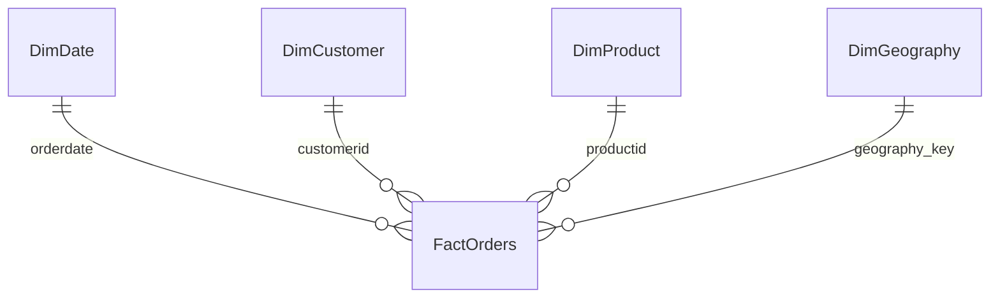

# Power BI handoff — validated import data, Desktop work pending

**Delivered here:** five reproducible CSV tables, unique dimension keys, checked foreign keys, SQL/fact reconciliation, a relationship specification, report layout and draft DAX measures. **Not delivered:** a PBIX, a published Power BI report, or executed DAX. This host is macOS; Microsoft lists Windows among [Power BI Desktop requirements](https://learn.microsoft.com/en-us/power-bi/fundamentals/desktop-get-the-desktop) (checked 2026-10-16).

## Generate and import

1. Run `python scripts/generate_demo_data.py`, `python -m src.data_loader`, `python -m src.reporting` from the repository environment.
2. In Power BI Desktop on supported Windows, Get Data → Text/CSV. Import each `bi/exports/*.csv` table under its exact filename stem. Use UTF-8; all IDs/text stay Text, `orderdate` Date (ISO yyyy-MM-dd), cent/quantity/key/year/month_number fields Whole Number. Do not infer numeric customer/product IDs.
3. Create the active relationships below: dimension (1) to fact (*), single-direction filtering from dimension to fact. Disable automatic relationships that introduce extra paths. Mark DimDate as the date table using `orderdate`; sort its `month` by ISO month (or use orderdate continuously). Hide fact foreign keys from report users.
4. Create each measure in `measures.dax` separately. Format revenue/value/AOV as USD with two decimals, returned shares as percentages. Zero denominator is BLANK (N/A). There is no status slicer in the specified report: status denominators refer to the selected date/category/country cohort.
5. Validate the baseline and each filtered cohort against `manifest.json` and the matching dashboard. Save a real PBIX and capture Power BI screenshots only after this Windows validation passes.

| Dimension key (unique) | FactOrders foreign key |
|---|---|
| DimDate.orderdate | orderdate |
| DimCustomer.customerid | customerid |
| DimProduct.productid | productid |
| DimGeography.geography_key | geography_key |

FactOrders grain is one order with one product. `orderid` is unique. Product category/brand live only in DimProduct. Geography represents the order location, not permanent customer residence. All money is USD by generated-data assumption; no conversion is performed. DimDate covers every calendar day between minimum and maximum order date.

## Report specification

- Header: “Retail operations | Synthetic USD demonstration”.
- Slicers: DimDate.orderdate, DimProduct.category, DimGeography.country.
- Cards: delivered merchandise revenue, orders, delivered AOV, returned share.
- Trend: continuous DimDate.orderdate (month) and delivered merchandise revenue.
- Category bar: DimProduct.category and delivered merchandise revenue.
- Outcome bars: FactOrders.orderstatus and order count. This is a descriptive chart, not a page filter. In Desktop, use Format → Edit interactions and set this chart’s interaction with every KPI/trend/category visual to None. Default cross-filtering would change status denominators and is outside this contract. Test clicking every outcome before saving.
- Tooltip/footer: recognition convention, returned-share denominator and synthetic-data notice.

## Verification boundary

Python tests prove export structure, relationships and SQL totals. They do not execute the Power Query import, DAX filter context or visual interactions. Those remain **Unverified** until a supported Windows/Desktop run. Do not list a completed Power BI dashboard on a résumé yet. DAX blank handling and distinct counting follow [DIVIDE](https://learn.microsoft.com/en-us/dax/divide-function-dax) and [DISTINCTCOUNT](https://learn.microsoft.com/en-us/dax/distinctcount-function-dax); relationship design follows Microsoft's [star-schema guidance](https://learn.microsoft.com/en-us/power-bi/guidance/star-schema) (checked 2026-10-16).
